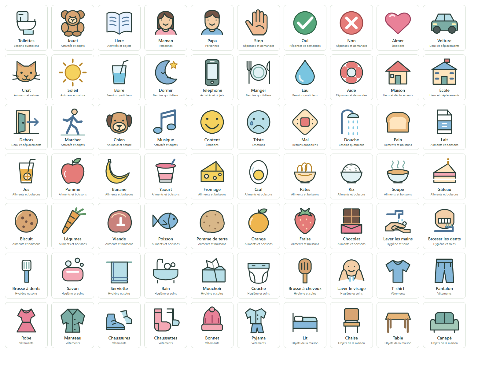
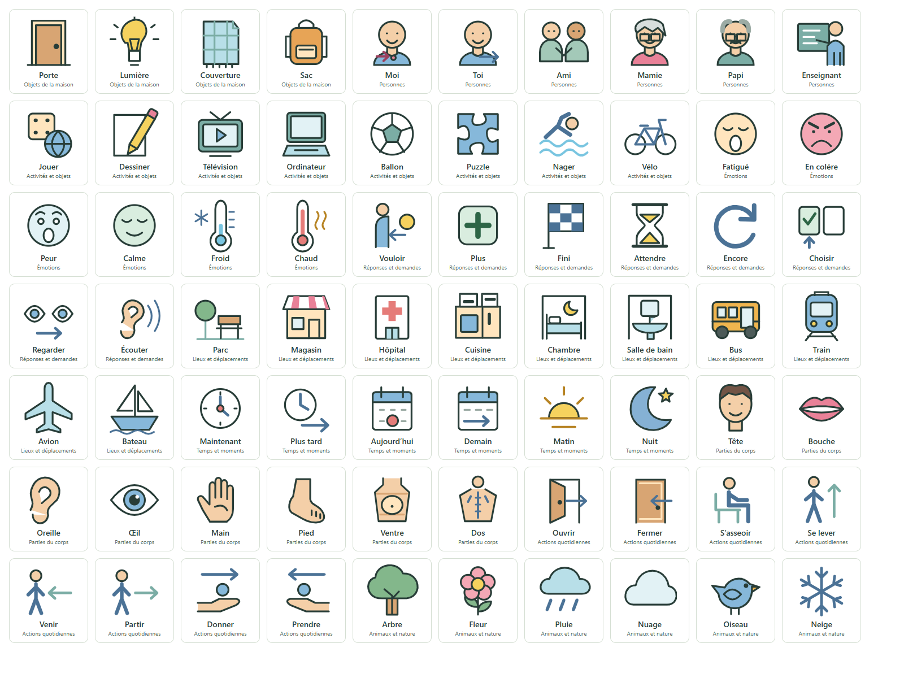

# 140 pictogrammes simples pour le quotidien

La bibliothèque passe de 28 à **140 dessins**, avec 112 ajouts originaux. Ils
reprennent les contours nets, les aplats de couleur et le cadre des dessins
existants. Une touche garde un grand dessin au-dessus du mot ; le libellé et le
sens personnel restent choisis pour chaque profil.

On trouve notamment : aliments et boissons (pain, lait, fruits, pâtes…), hygiène
(mains, dents, savon…), vêtements, meubles, parties du corps, Moi/Toi et entourage,
jeux et activités, émotions et sensations, demandes, actions, lieux, transports,
météo et temps. La recherche accepte les accents facultatifs et des synonymes
comme « grand-mère », « cacao » ou « recommencer ».

## Utiliser un nouveau dessin

1. Ouvrir **Clavier** dans le profil, puis rechercher un dessin ou une catégorie.
2. Choisir un pictogramme et adapter le mot et, si nécessaire, son sens personnel.
3. Créer la touche à vérifier, puis valider le dessin et le mot.
4. Retrouver la touche dans la communication et choisir explicitement sa place
   si celle proposée ne convient pas.

Rechercher et parcourir la bibliothèque ne crée aucune touche. Les profils ne
sont pas remplis automatiquement ; leurs places, images et sens existants sont
conservés. Les 28 anciennes références restent identiques. Les nouvelles
représentations restent propres au profil, présentes dans sa sauvegarde et dans
sa copie choisie du clavier pour les coupures. Après une mise à jour du serveur,
rafraîchir l’application et préparer à nouveau la copie hors connexion pour y
inclure les nouvelles touches choisies.

Les dessins sont des SVG locaux : aucun téléchargement d’image, service externe,
police emoji ou appel IA n’est nécessaire. Ils servent de supports ; leur
compréhension et leur pertinence pour la personne se vérifient avec elle.

## Aperçus des dessins

