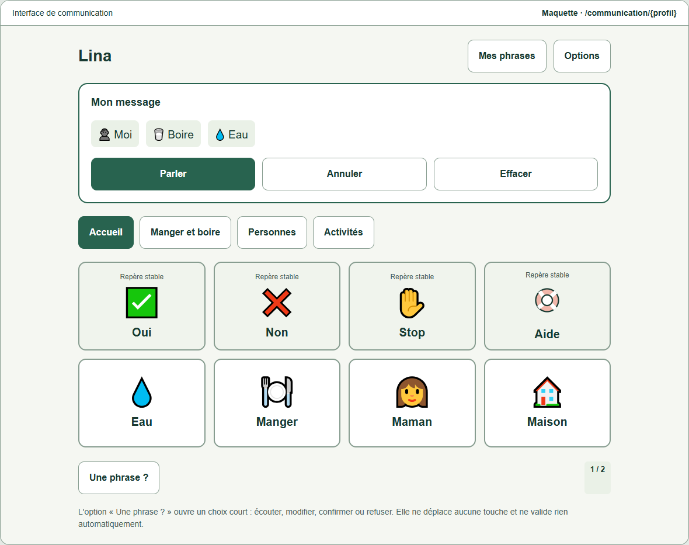
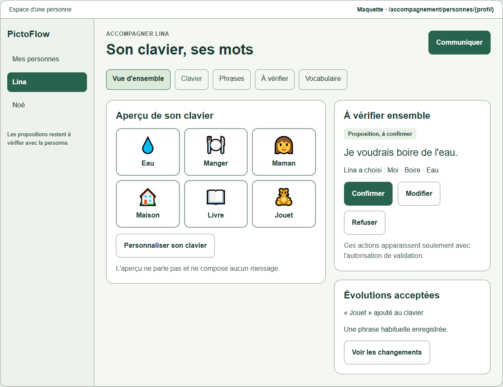
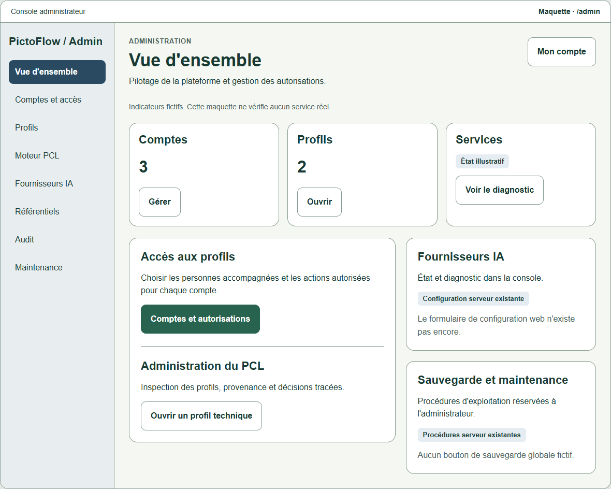

# Three-space wireframes

Read the [audit, permissions matrix and incremental plan](../UX_THREE_SPACES.md).

Download [three-spaces.html](three-spaces.html) and open it in a browser to navigate
six design screens: communication, supported people, person overview, keyboard
preparation, administration and accompanied access. The file is standalone; no
application server, dependency installation, credentials or network access is
needed. GitHub's file viewer displays its source rather than running the prototype.

The top navigation belongs to this design document. It is **not** a role chooser
for the actual product. In the proposed app, authenticated grants determine the
space. Buttons inside the mock screens only announce that they are illustrative;
they do not create messages, speak, validate meanings, change permissions or save
anything. Names, counts and communication content are fictitious. Emoji and one
simple SVG mark drawing positions; the implementation will reuse PictoFlow's
existing drawings and personal photos.

## Communication

The keyboard and message occupy the space. Preparation and system administration
have their own routes; phrases and optional human review remain deliberate choices.

## Accompaniment

A supporter starts from an authorized person, sees their keyboard and reviews
proposals only when that account has the relevant permission.

## Administration

Existing technical operations are grouped in a dedicated console. Provider web
configuration and global operational APIs that do not exist are identified as
future work, rather than presented as working controls.

## Design checks

All six screens were checked at 320, 390, 768 and 1280 CSS pixels in a local browser
(24 navigation/reflow checks). There were no horizontal overflows, JavaScript
errors or external network requests. Representative screenshots were visually
inspected. These are checks of a design artifact, not application authorization,
screen-reader certification or usability results from participants.
